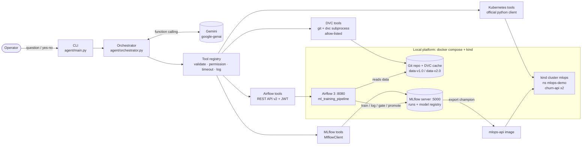
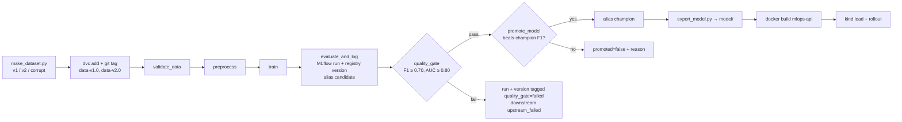
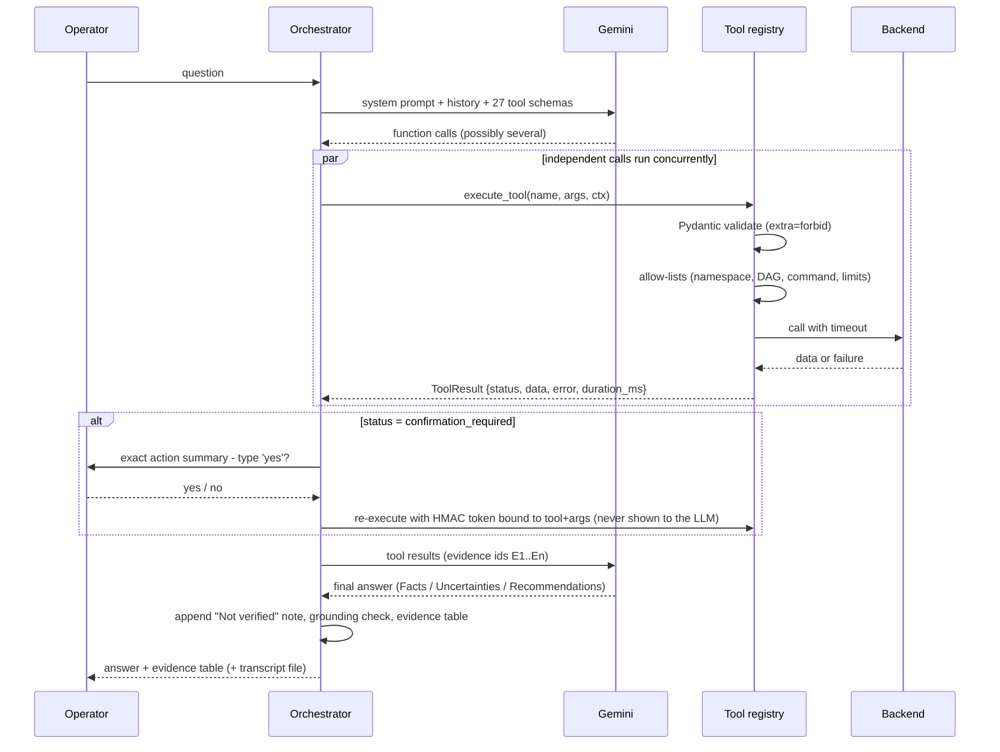

# Architecture

One conversational agent operates one ML application: a customer-churn classifier, from versioned data to a
serving deployment. The agent can **only** learn facts through typed tools. Every tool result carries an evidence
id, and the final answer ends with an evidence table generated from those results (not from LLM text).

## 1. System overview

## 2. ML lifecycle and provenance chain

Every MLflow run is tagged with `data.version`, `data.dvc_md5`, `data.file_md5`, `data.in_sync`, `git.commit`,
`dvc.remote` and `pipeline.run_id`. The serving container reports the model version, MLflow run id and dataset
version on `GET /version`. This is how the agent links **deployment → model → run → dataset** using evidence alone:
`k8s_get_deployed_version` → `mlflow_get_model_versions` → `dvc_get_run_dataset` (it re-checks the md5 against
the git tag).

The same stages exist twice:
- `dvc.yaml` (`dvc repro`) for local reproducibility.
- `dags/training_pipeline.py` for orchestrated runs, with retries and an isolated `/opt/ml-venv`.

## 3. Request flow inside the agent

## 4. Tool catalogue and permissions (27 tools)

R = read-only. W C = changes state and needs human confirmation collected by the orchestrator.

| System | Tool | Perm | Guard rails |
|---|---|---|---|
| DVC | `dvc_list_tracked_datasets` | R | reads `.dvc` / `dvc.lock` files |
| DVC | `dvc_get_current_version` | R | allow-listed `git` |
| DVC | `dvc_list_dataset_versions` | R | allow-listed `git` |
| DVC | `dvc_compare_versions` | R | `dvc diff`; revisions validated (no options, no ranges) |
| DVC | `dvc_detect_changes` | R | `dvc status`, `git status` |
| DVC | `dvc_get_run_dataset` | R | MLflow tags re-verified against git tag md5 |
| DVC | `dvc_reproduce_instructions` | R | optional checkout only into an isolated scratch `git worktree` |
| MLflow | `mlflow_list_experiments` | R | `MlflowClient`, retries capped, 10 s HTTP timeout |
| MLflow | `mlflow_list_runs` | R | |
| MLflow | `mlflow_get_run` | R | |
| MLflow | `mlflow_best_run` | R | filters: dataset version, gate passed, recency |
| MLflow | `mlflow_compare_runs` | R | 2..10 validated run ids |
| MLflow | `mlflow_get_model_versions` | R | aliases champion / candidate |
| Airflow | `airflow_list_dags` | R | JWT, cached and refreshed on 401 |
| Airflow | `airflow_list_dag_runs` | R | |
| Airflow | `airflow_get_task_instances` | R | first failed task, upstream_failed list |
| Airflow | `airflow_get_task_logs` | R | tail clamped (≤ 200 lines), redacted |
| Airflow | `airflow_trigger_dag` | W C | approved DAG list; `data_path` must be `data/**.csv` |
| K8s | `k8s_list_deployments` | R | namespace allow-list on **every** tool |
| K8s | `k8s_list_pods` | R | |
| K8s | `k8s_get_pod_logs` | R | scans ≤ 2000 lines for errors, returns a short tail |
| K8s | `k8s_get_events` | R | |
| K8s | `k8s_get_services` | R | ready endpoints via EndpointSlices |
| K8s | `k8s_find_unhealthy` | R | not-Ready / CrashLoop / restarts / stalled rollout / no endpoints |
| K8s | `k8s_get_deployed_version` | R | image, labels, ConfigMap, live `/version` via API-server proxy |
| K8s | `k8s_restart_deployment` | W C | `mlops-demo` only |
| K8s | `k8s_scale_deployment` | W C | `mlops-demo` only, replicas 1..5 |

The cluster side mirrors these rules. The `mlops-agent` ServiceAccount (`kubernetes/rbac.yaml`) can read in
`mlops-demo` and only `patch` deployments and their scale subresource. It has no Secrets, no delete or create,
and no other namespaces.

## 5. Failure handling contract

| Situation | Tool status | What the user sees |
|---|---|---|
| Backend unreachable (connection refused, DNS, kubeconfig missing) | `unavailable` | "Not verified" note naming the system; LLM told not to fill the gap |
| Tool exceeded its timeout | `timeout` | same as above |
| Bad arguments from the LLM | `error` (`ValidationError`) | LLM sees the validation message and can correct itself |
| Policy violation (namespace, DAG, command, replicas) | `rejected` | refusal with the rule that was violated; no API call made |
| Write tool without approval | `confirmation_required` → human prompt | nothing executes unless the human types `yes` |
| LLM API down / quota | orchestrator `stopped_reason=llm_error` | honest error, no answer invented |
| Figures in the answer not present in any tool result | — | "Grounding check" warning listing them |

## 6. Deployment topology

| Component | Where | Port | Notes |
|---|---|---|---|
| MLflow 3.18 | docker compose (`infra/docker-compose.yml`) | 5000 | sqlite backend, proxied artifact store (`--serve-artifacts`) |
| Airflow 3.1 | docker compose: api-server, scheduler, dag-processor, Postgres 16 | 8080 | LocalExecutor, FAB auth, REST API v2 |
| churn-api | kind cluster `mlops`, ns `mlops-demo` | Service :80 → 8000 | 2 replicas, RollingUpdate `maxUnavailable: 0`, probes, requests/limits, ConfigMap, non-root, read-only rootfs |
| Agent | host (`uv run python -m agent.main`) | — | Python 3.12, kubeconfig context `kind-mlops` |
