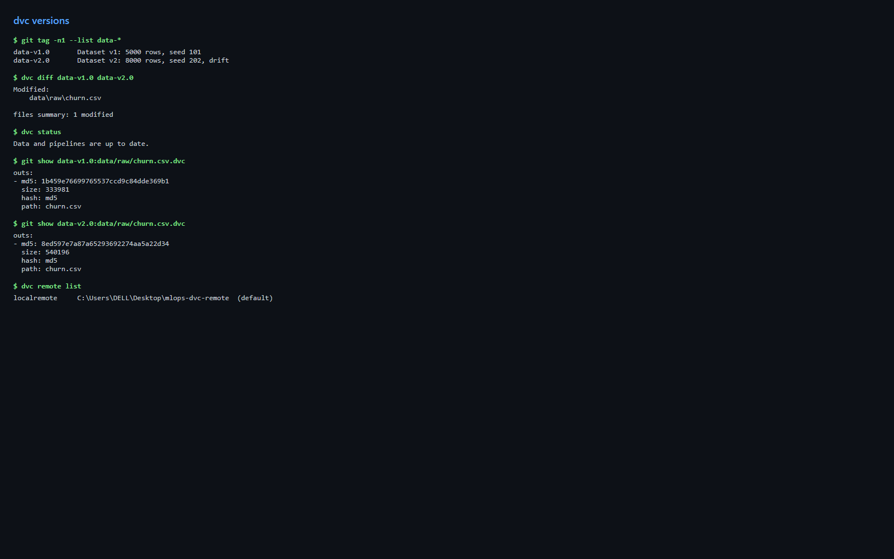
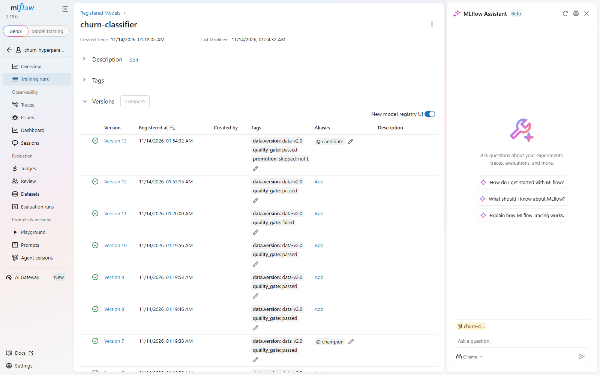
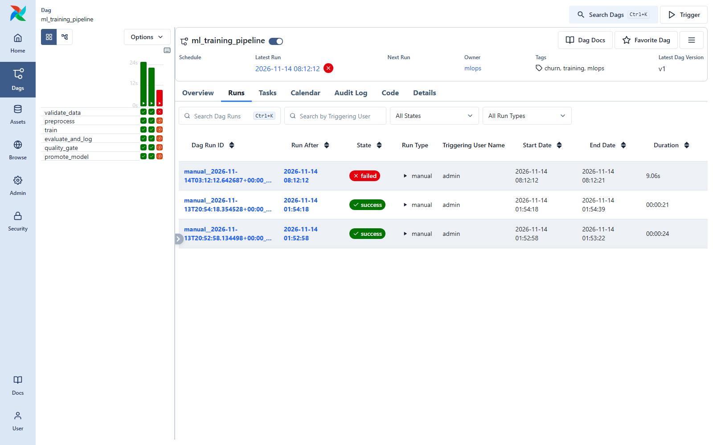
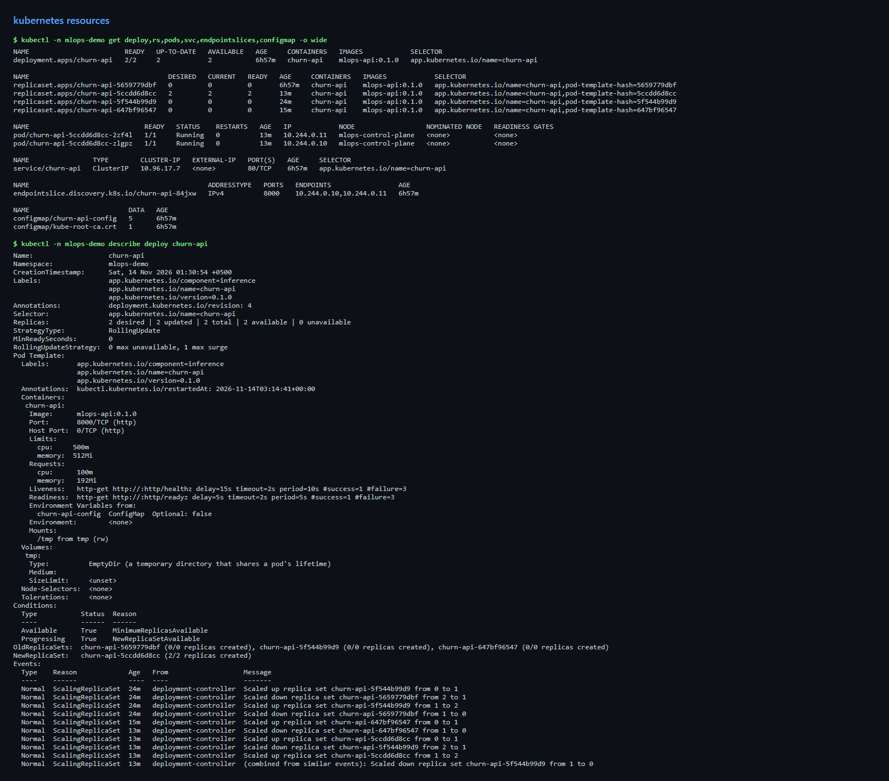

# Technical Report: Production-Ready MLOps AI Agent

**Course:** MLOps & Production AI Engineering, Assignment 03
**Repository:** https://github.com/Myt1x54/assignment-03-mlops-agent

## Contents

1. [Summary](#1-summary)
2. [Architecture](#2-architecture)
3. [Tool definitions and permissions](#3-tool-definitions-and-permissions)
4. [Evidence from the four systems](#4-evidence-from-the-four-systems)
5. [Five tested conversations](#5-five-tested-conversations)
6. [Failure investigations](#6-failure-investigations)
7. [Testing, reliability and CI](#7-testing-reliability-and-ci)
8. [Safety model](#8-safety-model)
9. [Engineering decisions (defense)](#9-engineering-decisions-defense)
10. [Limitations and improvements](#10-limitations-and-improvements)

---

## 1. Summary

A single conversational agent operates one ML application, a customer-churn classifier, across its whole
lifecycle:

| Layer | Implementation |
|---|---|
| Data versioning | DVC + Git tags `data-v1.0` (5,000 rows), `data-v2.0` (8,000 rows, drifted); local DVC remote |
| Experiments and registry | MLflow 3.18 server; 15 runs in 2 experiments; registered model `churn-classifier`, aliases `champion` / `candidate` |
| Orchestration | Airflow 3.1 DAG `ml_training_pipeline`: validate → preprocess → train → evaluate+log → quality gate → promote |
| Serving | FastAPI `churn-api` on a kind cluster: 2 replicas, ClusterIP, probes, requests/limits, ConfigMap, RBAC |
| Agent | Gemini (free tier) with function calling over **27 typed tools**; hand-written orchestrator; CLI with transcripts |

The agent's core property is that **every operational statement is backed by a tool result from the same
request**:
- each fact cites an evidence id (`[E3]`);
- the evidence table at the end of every answer is generated from the actual `ToolResult` objects, not from LLM
  text;
- deterministic post-checks flag failed systems ("Not verified"), figures that appear in no tool result
  ("Grounding check"), citations of non-existent evidence ("Citation check") and retraining verdicts given
  without evidence for every policy criterion ("Retraining verdict check").

## 2. Architecture

Full diagrams (system overview, ML lifecycle and provenance chain, request sequence) are in
[`architecture.md`](../../architecture.md). In short:

```
Operator ──► CLI ──► Orchestrator ◄──function calling──► Gemini
                         │
                  Tool registry (validate → policy → timeout → envelope → JSON log)
         ┌──────────────┬──────────────┬──────────────┐
      DVC tools     MLflow tools   Airflow tools   Kubernetes tools
   git/dvc (allow-   MlflowClient   REST v2 + JWT   python client
   listed, no shell)                                (namespace-scoped)
```

**Provenance chain:**
- Every MLflow run is tagged with `data.version`, `data.dvc_md5`, `data.file_md5`, `data.in_sync`, `git.commit`,
  `dvc.remote` and `pipeline.run_id`.
- The serving container exposes model version, run id and dataset version on `GET /version`.
- The agent can therefore link *deployment → registry version → run → dataset → git tag* using evidence alone.
  `dvc_get_run_dataset` re-verifies the recorded md5 against the `.dvc` pointer stored at the git tag.

**Training pipeline (DAG):**
- Transient steps get 2 retries with exponential backoff.
- `validate_data` and `quality_gate` fail fast (0 retries): bad data or a weak model does not improve with
  retries.
- The default `all_success` rule means a failed check leaves everything downstream `upstream_failed`.
- `promote_model` applies a champion/challenger rule (D32): `champion` moves only on a strictly higher F1.

## 3. Tool definitions and permissions

| System | Tools | Count | State-changing |
|---|---|---|---|
| DVC | list tracked data, current version, versions, compare (`dvc diff`), detect changes (`dvc status`), run → dataset, reproduce (+ isolated scratch checkout) | 7 | none |
| MLflow | experiments, runs, run detail, best run (metric/direction, dataset, gate, recency filters), compare runs, registry versions/aliases | 6 | none |
| Airflow | DAGs, DAG runs, task instances (first failure, upstream_failed), task logs, trigger | 5 | `airflow_trigger_dag` (approved DAG + confirmation) |
| Kubernetes | deployments, pods, pod logs, events, services (ready endpoints), health sweep, deployed version, restart, scale | 9 | `k8s_restart_deployment`, `k8s_scale_deployment` (namespace + confirmation; replicas 1..5) |

The table with every tool and its guard rails is in [`architecture.md` §4](../../architecture.md#4-tool-catalogue-and-permissions-27-tools).

**Tool contract:**
- Each tool lives in `agent/tools/<system>_tools.py` and has a Pydantic input model (`extra="forbid"`).
- Each runs under a timeout and returns the common envelope
  `{tool, request_id, status, data, error, duration_ms, evidence_id}`.
- `status` is one of `ok | error | timeout | unavailable | rejected | confirmation_required`.
- Tools never raise to the orchestrator.

## 4. Evidence from the four systems

### DVC

`git tag` shows both dataset versions. `dvc diff data-v1.0 data-v2.0` shows the modified dataset, `dvc status` is
clean, and the `.dvc` pointers carry the md5s at each tag. The pipeline graph and metrics are in
[`dvc_pipeline.png`](../../screenshots/dvc_pipeline.png).

Reproducibility was verified twice:
- checking out `data-v1.0` restores md5 `1b459e76…` exactly;
- `scripts/bootstrap_data.py` regenerates both versions byte-for-byte on a fresh clone and checks them against
  the tagged pointers.

### MLflow

- **Registry:** v7 = `champion` (gate passed). v13 = `candidate`, tagged `promotion: skipped: not better than
  champion`. v11 has `quality_gate: failed`.
- **Run views:** [`mlflow_experiment_runs.png`](../../screenshots/mlflow_experiment_runs.png),
  [`mlflow_hyperparam_search.png`](../../screenshots/mlflow_hyperparam_search.png) and
  [`mlflow_champion_run.png`](../../screenshots/mlflow_champion_run.png).
- **Failed-gate run:** [`mlflow_failed_gate_run.png`](../../screenshots/mlflow_failed_gate_run.png) shows its
  provenance tags and the reason `roc_auc 0.6438 < min_roc_auc 0.8`.

### Airflow

- The run list and task grid show the injected F2 failure (red `validate_data`, orange `upstream_failed`
  downstream) next to successful runs.
- More views: [`airflow_dags.png`](../../screenshots/airflow_dags.png) and
  [`airflow_dag_graph.png`](../../screenshots/airflow_dag_graph.png).

### Kubernetes

- `kubectl get deploy,rs,pods,svc,endpointslices,configmap` and `describe deploy` show 2 replicas, probes,
  requests/limits, ConfigMap env and the ClusterIP Service.
- RBAC of the agent's ServiceAccount: [`kubernetes_rbac_guard.png`](../../screenshots/kubernetes_rbac_guard.png).
  `patch deployments` = yes; `delete`, other namespaces and Secrets = no.

## 5. Five tested conversations

All transcripts were produced with the real CLI against the live platform and are stored unedited, apart from the
model label in S1, in [`transcripts/`](transcripts/). Each lists every tool call with arguments, status and
latency, then the answer and the evidence table. No secret appears in any transcript (redaction is applied on
save).

| # | Scenario | Transcript | Tool path (systems) | Outcome |
|---|---|---|---|---|
| S1 | Dataset provenance | [S1-dataset-provenance.md](transcripts/S1-dataset-provenance.md) | `k8s_get_deployed_version` → `dvc_list_tracked_datasets`, `dvc_list_dataset_versions`, `dvc_get_run_dataset`, `dvc_compare_versions`, `dvc_reproduce_instructions` (K8s, DVC, MLflow) | Production model v7 trained on `data-v2.0`; md5 verified against the git tag; v1 vs v2 differences; exact reproduction commands |
| S2 | Model selection | [S2-model-selection.md](transcripts/S2-model-selection.md) | `mlflow_list_experiments`, `mlflow_list_runs`, `mlflow_get_model_versions`, `k8s_get_deployed_version`, `dvc_get_current_version` (MLflow, K8s, DVC) | Highest F1 (0.8121) is also the right production choice *because* it passed the gate, uses the current dataset and is the deployed champion; v13 skipped as not better |
| S3 | Pipeline execution | [S3-pipeline-execution.md](transcripts/S3-pipeline-execution.md) | `airflow_trigger_dag` (**confirmed by the human**) → *(75 s)* → `airflow_list_dag_runs`, `airflow_get_task_instances`, `mlflow_list_runs`, `mlflow_get_run`, `mlflow_get_model_versions` | Real DAG run; all 6 tasks `success`; metrics logged; gate passed; champion **unchanged** (F1 0.8026 < 0.8121, D32). Shows self-correction after a wrong experiment name |
| S4 | Deployment diagnosis + guard rails | [S4-deployment-diagnosis-and-guardrails.md](transcripts/S4-deployment-diagnosis-and-guardrails.md) | `k8s_list_pods`, `k8s_get_services`, `k8s_get_events`, `k8s_find_unhealthy`, `k8s_get_pod_logs` ×2; then `k8s_scale_deployment(10)`, `k8s_restart_deployment` | Healthy 2/2, 2 endpoints, 0 restarts; old probe warnings correctly attributed to replaced pods. Scale to 10 → **rejected** (policy 1..5); restart in `default` → **rejected** (`IntentMismatch`, D37) |
| S5 | **Mandatory multi-tool scenario** | [S5-mandatory-multi-tool-scenario.md](transcripts/S5-mandatory-multi-tool-scenario.md) | `mlflow_best_run`, `k8s_get_deployed_version`, `k8s_find_unhealthy`, `airflow_list_dag_runs`, `dvc_list_dataset_versions`, `mlflow_list_runs`, `mlflow_get_run`, `airflow_get_task_instances` (**all four systems**) | Best model = v7 (F1 0.8121) on `data-v2.0` (= newest dataset); deployed and healthy 2/2; latest pipeline run success (earlier F2 failure noted at `validate_data`, not at the gate); model 0.6 days old → **retraining not indicated**. No DAG triggered |

The S5 answer uses the required structure: **Facts (with evidence) / Uncertainties / Recommended actions**.
Retraining is evaluated against each policy criterion in `config/agent_policy.yaml` and is never started by the
analysis.

## 6. Failure investigations

Written up in detail in [`failures.md`](failures.md):

| ID | Kind | Root cause found by the agent | Resolution |
|---|---|---|---|
| **F1** | Injected (Kubernetes) | ConfigMap `MODEL_PATH` points to a missing file → `FileNotFoundError` in pod logs → `/readyz` 503 → stalled rollout (old pods keep serving thanks to `maxUnavailable: 0`) | Operator fixes ConfigMap; agent restarts **after human `yes`**; agent verifies 2/2 healthy serving v7 |
| **F2** | Injected (Airflow/data) | Corrupt batch: 400 null tenures, 120 out-of-range charges, 60 unknown contract types → `validate_data` failed; 5 downstream tasks `upstream_failed`; nothing promoted | Batch removed; next run on the DVC dataset succeeded (S3) |
| F3 | Injected (MLflow down) | All MLflow calls `unavailable`; answer contains no MLflow metrics, takes the deployed version from the live service instead, footer marks the gaps; the **retraining verdict check** (D38) downgrades the model's verdict to *cannot be fully determined* | `docker start mlflow` |
| **U1** | **Unexpected** | LLM replaced the user-named namespace `default` with `mlops-demo`; caught by the human confirmation; prompt rule alone did not fix it | Deterministic `IntentMismatch` guard (D37), extended to deployment/DAG/replicas (D38) + tests; re-run rejects both calls |

## 7. Testing, reliability and CI

| | |
|---|---|
| Unit tests | **144**, all external services mocked (fake MLflow client, fake Airflow REST, fake K8s APIs, fake git/dvc subprocess, scripted LLM); about 10 s |
| Live integration tests | 10 (`pytest -m integration`), including "the MLflow champion is the deployed model" |
| Coverage | 77% of `agent/`, `training/`, `api/` |
| CI | GitHub Actions on every PR and push: `uv sync --locked`, ruff lint + format check, pytest + coverage artifact, `kubeconform -strict` on the manifests, check of required Deployment settings |

The required tests map to `tests/test_orchestrator.py`:

| Requirement | Test(s) |
|---|---|
| Tool selection and result flow | `test_tool_selection_result_flows_back_to_llm` |
| Multi-tool request (4 systems) | `test_multi_tool_request_spans_all_four_systems` |
| Timeout | `test_tool_timeout_is_reported` (+ core `test_timeout_maps_to_timeout_status`) |
| Invalid request | `test_invalid_tool_input_returns_validation_error_to_llm` |
| Service failure | `test_mlflow_down_is_unavailable` (+ per-system unavailable tests) |
| **No invention** | `test_no_invention_when_kubernetes_unavailable`, `test_grounding_check_flags_invented_figures`, `test_citation_check_flags_nonexistent_evidence` |
| **Unauthorized K8s change rejected** | `test_unauthorized_k8s_change_wrong_namespace_rejected`, `test_k8s_change_declined_by_human_is_not_executed`, `test_llm_substituting_the_named_namespace_is_rejected` |
| Non-approved DAG | `test_non_approved_dag_trigger_rejected` |
| Structured logs without secrets | `test_structured_logs_have_fields_and_no_secrets` |
| Quality gate / data validation / API | `tests/test_training_and_api.py` |

**Structured logs:**
- Format: one JSON line per event, carrying `ts`, `level`, `logger`, `request_id` and `msg`. Tool lines add
  `tool`, `status`, `duration_ms` and `error_type`.
- Secrets are redacted from messages and extra fields. Redaction uses known values from settings plus patterns
  (Google keys, bearer tokens/JWTs, `password=`/`token=`).

Captured from the live platform (one read call and one rejected write in the same request):

```json
{"ts": "2026-11-14T10:41:44.374+00:00", "level": "INFO", "logger": "agent.tools", "request_id": "req-logdemo01", "msg": "tool call", "tool": "airflow_list_dag_runs", "status": "ok", "duration_ms": 168, "error_type": null}
{"ts": "2026-11-14T10:41:44.374+00:00", "level": "INFO", "logger": "agent.tools", "request_id": "req-logdemo01", "msg": "tool call", "tool": "k8s_restart_deployment", "status": "rejected", "duration_ms": 0, "error_type": "PermissionDeniedError"}
```

## 8. Safety model

| Threat | Control (in code) |
|---|---|
| LLM triggers an action on its own | Write tools return `confirmation_required`; only the orchestrator can re-execute, after a human types `yes`, with an HMAC token bound to tool + exact args, valid 5 min and never shown to the LLM (D13, D33) |
| LLM passes `confirmed=true` | All inputs `extra="forbid"` → validation error (`test_llm_cannot_inject_confirmation_field`) |
| Wrong namespace / DAG / scale | Allow-lists checked **before** any confirmation or API call (`rejected`) |
| LLM substitutes the user's target | `IntentMismatch` guard for namespace, deployment, DAG id and replica count (D37, D38) |
| Arbitrary commands | `git`/`dvc` subcommand allow-list, `shell=False`, revision and path validation (no options, ranges or `..`) |
| Dataset checkout damaging the workspace | Only into an isolated scratch `git worktree` |
| Cluster blast radius | ServiceAccount RBAC: read + `patch` deployments in `mlops-demo` only; no Secrets |
| Secret leakage | `.env` only (gitignored), `SecretStr`, redaction in logs, tool output and transcripts; CI needs no secrets |
| Hallucinated facts | Evidence ids, generated evidence table, Not-verified footer, grounding, citation and retraining-verdict checks |

## 9. Engineering decisions (defense)

The full log is [`DECISION.md`](../../DECISION.md) (D0-D38). The choices most likely to be questioned:

- **Hand-written orchestrator instead of LangChain/LangGraph (D3).**
  - About 310 lines, fully testable with a scripted LLM.
  - It is the place where the non-negotiable rules live: confirmation, evidence table, post-checks.
  - A framework would hide exactly the part that has to be auditable.
- **Gemini free tier (D25, D35, D36).** No cost and native function calling. The free tier forced real
  engineering:
  - a 60 s HTTP timeout;
  - honouring `retryDelay` on per-minute 429s;
  - automatic fallback across models on per-day quota;
  - correct replay of thought signatures across model switches.
- **kind (D26).** The cluster is created and destroyed from one config file, images load without a registry, and
  it behaves like real Kubernetes (probes, RBAC, EndpointSlices, API-server service proxy).
- **Two quality controls (D10, D32).**
  - An absolute gate (F1 ≥ 0.70, ROC-AUC ≥ 0.80).
  - A champion/challenger rule. It was added after the first real DAG run promoted a *worse* model: a correct
    gate is not enough to prevent regressions.
- **Read-only-by-default tools with confirmation on writes (D13, D34).** Triggering training also needs
  confirmation, because a run creates registry versions and may move `champion`.
- **Provenance verified, not just recorded (D7).** Tags are cross-checked against git, so a tampered or stale tag
  shows `verified_against_git: false`.
- **skops with explicit trusted types (D29).** Keeps MLflow's safer serialization instead of falling back to
  pickle.

## 10. Limitations and improvements

| Limitation | Improvement |
|---|---|
| Free-tier quotas (≈20 requests/day/model) limit how many conversations can run per day; lite models sometimes guess arguments (fixed by tool errors and self-correction) | Paid tier or a stronger model; argument enumerations (e.g. experiment names) injected into tool schemas at start-up |
| The grounding check is a regex over numbers and versions; it cannot catch invented *qualitative* claims | Claim extraction + entailment check against tool payloads; or require every sentence to carry a citation |
| The intent guard and verdict check are regex-based; unusual phrasings (e.g. a deployment named without the word "deployment") are not enforced | Structured intent extraction (a constrained LLM call or a slot-filling parser) compared field-by-field with each write call |
| Single-user CLI; confirmations on stdin | Web/Slack front end with authenticated approvers and an audit log of approvals |
| Local stack: sqlite MLflow backend, local DVC remote, LocalExecutor | Postgres + S3/MinIO for MLflow and DVC, CeleryExecutor or KubernetesExecutor, Airflow and MLflow deployed into the cluster |
| Airflow tasks share the repo workspace with local `dvc repro` (outputs overwrite each other) | Run DAG tasks in their own worktree or container image with the code baked in; store outputs only as MLflow/DVC artifacts |
| Model rollout is manual (export → build → kind load → apply) | A `deploy_champion` DAG task or Argo CD watching the registry alias, with canary rollout gated on live metrics |
| No production monitoring of model quality | Prometheus metrics from `/predict`, drift detection on inputs, scheduled evaluation feeding the retraining policy |
